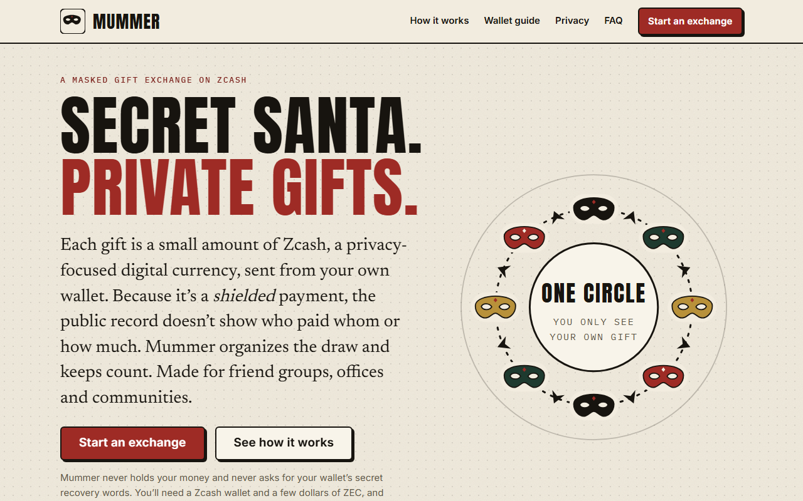
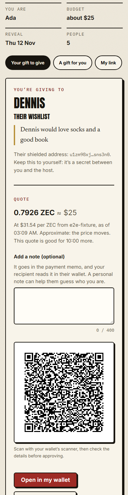

# Mummer

**A privacy-focused, noncustodial Secret Santa where the gifts are small shielded Zcash payments sent from people's own wallets.**

> **Status: not deployed.** There is no live URL yet. No push or deployment was made because no destination was designated. Everything below describes what runs locally and what the tests show. See [`docs/FINAL_AUDIT.md`](docs/FINAL_AUDIT.md) for what is and isn't verified.



*Real screenshots from the test browser against a local build. Prices in some screenshots read "e2e-fixture" because tests use a fixed price.*

## The problem

On most blockchains every payment is public, which defeats the point of a secret gift. Collecting everyone's payment details in a group chat is awkward and leaks them. And organisers end up chasing "did yours show up?" without being able to say who sent what.

## How it works

1. **Start an exchange.** Name it, set a budget and two dates, share one invite link.
2. **Everyone joins.** Each person picks a nickname, an optional wishlist and a fresh shielded receiving address from their own wallet. These are sealed in the browser to the host's key before anything is sent.
3. **The host draws.** The host's browser draws the names (a single cycle, so nobody draws themselves) and seals each person's assignment so only that person can open it.
4. **Send your gift.** Mummer builds a ZIP 321 payment request (QR plus copyable address, amount and memo). The person's own wallet shows it and the person approves and sends. Mummer never touches funds.
5. **Confirm and reveal.** Recipients say what arrived. On reveal day, givers may choose to unmask. Everything is optional and self-reported.



## Features

- Real ZIP 316 unified-address decoding (checksum, jumble, receivers) and a policy that requires a mainnet shielded receiver
- Single-recipient ZIP 321 payment requests with exact zatoshi math and a memo within the 512-byte limit
- Client-side encryption (libsodium sealed boxes), padded blobs, tokens stored only as hashes
- Private links kept in the URL fragment, Argon2id passphrase backups, link replacement
- Aggregate-only progress for the host, a "glass box" that shows exactly what the server stores (sealed values as sizes and fingerprints)
- Consent-gated reveals; thresholded public stats
- Responsive from 320 to 1920 px (including landscape) and keyboard accessible

## Privacy and trust model

Read [`docs/PRIVACY.md`](docs/PRIVACY.md), [`docs/THREAT_MODEL.md`](docs/THREAT_MODEL.md) and the in-app "Who can see what" page. In short:

- **Mummer's server and database cannot read addresses, wishlists or pairings.** This is checked by tests that scan every request and stored value.
- **The host's browser runs the draw and could see who draws whom.** This is a *trusted-host* design; a host-blind draw was not built. The app offers "I'm only organizing" so the host need not play.
- **A malicious operator who serves altered JavaScript could read secrets or swap addresses.** Address commitments and a host-key fingerprint in the invite detect database-only swaps, not this.
- Hosting and network providers see connections. Small groups leak by deduction (use 5 or more).
- "Sent" and "received" are self-reports. Mummer cannot see a shielded payment and never labels anything "verified".

## Stack

npm workspaces monorepo: TypeScript 5.9, React 19 + Vite + React Router, a Cloudflare Worker (Hono) with D1, Zod, libsodium, Vitest, Playwright and axe-core. Packages: `packages/zcash` (addresses, ZIP 321, memos), `crypto`, `draw`, `shared`; apps: `apps/web`, `workers/api`.

## Verified integrations

| Integration | Status |
|---|---|
| ZIP 316 unified addresses | **Verified** against the official test vectors (60 Rev 0 and 60 Rev 2 plus F4Jumble vectors) |
| ZIP 321 payment requests | **Verified** against the specification examples; round trips and tamper detection |
| Zodl wallet scanning a Mummer QR | **Not verified** (needs devices and funds). The app never claims a scan prefilled anything and always offers copy buttons |
| Real shielded payment end to end | **Not done** |
| Cloudflare Turnstile | **Not run** (no account). The ticket flow and sandboxed frame are tested with a stub |

Details: [`docs/INTEGRATION_RESEARCH.md`](docs/INTEGRATION_RESEARCH.md).

## Setup

```bash
npm ci
npx playwright install chromium
```

Full instructions (local Worker, database migrations, environment): [`docs/SETUP.md`](docs/SETUP.md).

## Testing

```bash
npm run typecheck
npm test               # 361 Vitest tests: unit, API on a real D1 (Miniflare), security
npm run build
npx playwright test    # 50 browser tests; starts its own server on :8788
```

What each layer proves, the test doubles in use and one open flake: [`docs/TESTING.md`](docs/TESTING.md). Run history and what was not run: [`docs/EVIDENCE.md`](docs/EVIDENCE.md).

## Deployment

Not deployed. Steps, required secrets and the post-deploy checklist are in [`docs/DEPLOYMENT.md`](docs/DEPLOYMENT.md).

## Demo and evidence

[`docs/DEMO.md`](docs/DEMO.md) is a plan for a recorded demo using only test addresses and no real keys. [`docs/EVIDENCE.md`](docs/EVIDENCE.md) lists every check and its result.

## Documentation

| Topic | File |
|---|---|
| Architecture and decisions | [`ARCHITECTURE`](docs/ARCHITECTURE.md), [`DECISIONS`](docs/DECISIONS.md), [`API`](docs/API.md) |
| Privacy and security | [`PRIVACY_ARCHITECTURE`](docs/PRIVACY_ARCHITECTURE.md), [`CRYPTOGRAPHIC_DESIGN`](docs/CRYPTOGRAPHIC_DESIGN.md), [`THREAT_MODEL`](docs/THREAT_MODEL.md), [`SECURITY`](docs/SECURITY.md), [`PRIVACY`](docs/PRIVACY.md), [`PRIVACY_AUDIT`](docs/PRIVACY_AUDIT.md) |
| Quality | [`REQUIREMENTS_MATRIX`](docs/REQUIREMENTS_MATRIX.md), [`VALIDATION_REGISTER`](docs/VALIDATION_REGISTER.md), [`COPY_AUDIT`](docs/COPY_AUDIT.md), [`TESTING`](docs/TESTING.md), [`EVIDENCE`](docs/EVIDENCE.md), [`FINAL_AUDIT`](docs/FINAL_AUDIT.md) |
| Operations | [`SETUP`](docs/SETUP.md), [`DEPLOYMENT`](docs/DEPLOYMENT.md), [`RECOVERY`](docs/RECOVERY.md), [`DEMO`](docs/DEMO.md) |

## Limitations

Trusted-host draw; no independent payment proof; no company-funded mode; no real-wallet testing; not deployed; no third-party security review; no manual screen-reader pass. The full list is [`docs/KNOWN_LIMITATIONS.md`](docs/KNOWN_LIMITATIONS.md).

## License

See [`LICENSE`](LICENSE).
